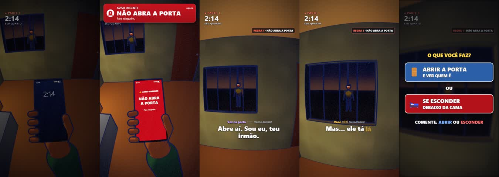

# historias-pov

**Crie séries curtas de terror (ou suspense) em primeira pessoa para TikTok, Reels e Shorts, conversando com o Claude.**
Você pede "monta uma história", responde algumas perguntas e escolhe uma ideia. A partir daí, o Claude conduz o resto por etapas, e você aprova cada uma, até o episódio 1 completo: roteiro com abertura forte, vozes com emoção, animação com personagens em estilo desenho num mundo 3D, som, legendas e cartão de votação.



Não precisa saber programar. O **[guia em PDF](docs/GUIA-PASSO-A-PASSO.pdf)** explica tudo, da instalação ao primeiro episódio: quanto custa, como criar a conta e a chave da ElevenLabs e o que fazer quando algo dá errado.

## Instalar (um comando)

**Windows:** abra o **PowerShell** (menu Iniciar → digite "PowerShell") e cole:

```powershell
irm https://raw.githubusercontent.com/nexcorsair-create/skill-pov-3d/main/instalar.ps1 | iex
```

**Mac:** abra o **Terminal** e cole:

```bash
curl -fsSL https://raw.githubusercontent.com/nexcorsair-create/skill-pov-3d/main/instalar.sh | bash
```

O instalador mostra a lista do que vai fazer e só faz **uma pergunta: se você confirma**. Ele:
1. instala o que faltar: Node.js, ffmpeg, Python e faster-whisper, todos grátis;
2. copia a skill `historia-pov` para o Claude;
3. cria a pasta de trabalho `HistoriasPOV` na sua pasta de usuário;
4. faz um teste rápido do 3D.

Leva de 5 a 20 minutos. Também dá para baixar este repositório (botão **Code → Download ZIP**), descompactar e dar dois cliques em `instalar.cmd` (Windows) ou rodar `bash instalar.sh` (Mac).

Opções: pasta de trabalho em outro lugar (`-Pasta D:\Videos` no Windows, `--pasta ~/Videos` no Mac); instalar também o Earshot, o "ouvido" do Claude para conferir o som, com ~2 GB (`-ComEarshot` / `--com-earshot`).

## Usar

1. Abra o **Claude Code** na pasta `HistoriasPOV`.
2. Peça: **monta uma história**.
3. Responda às perguntas (tema, público, idioma, duração, quanto quer gastar, se vai ter votação) e escolha uma ideia.
4. Aprove cada etapa. O Claude avisa antes de qualquer coisa que gaste créditos.

## Quanto custa

Tudo é grátis, **menos as vozes finais** (ElevenLabs, paga por créditos). Medido em séries reais:
- episódio 1 num idioma, sem amostras de voz: **~200 a 400 créditos**;
- com amostras: **~500 a 800 créditos**.

A voz de rascunho, a escolha de vozes pelas prévias, a animação, o som (sons CC0 do Openverse) e as legendas não custam nada. Detalhes e planos no guia PDF.

## A sua chave fica só com você

- O pacote **não tem nenhuma chave**. Você cria a sua na ElevenLabs e cola num arquivo `estudio/.env.local`, feito a partir do `estudio/.env.example`. O Claude nunca vê nem pede a chave.
- O `.gitignore` impede que chaves (`.env*`), renders, áudios e as suas histórias subam para o GitHub.
- Para quem for contribuir, `node ferramentas/varrer_segredos.mjs` procura chaves, tokens, e-mails, caminhos pessoais e arquivos pesados. Para ativar a trava que roda antes de todo commit: `git config core.hooksPath .githooks`.

## O que tem aqui

| Pasta | O quê |
|---|---|
| `skill/historia-pov/` | A skill: método por etapas, 11 guias, modelos de documento |
| `skill/historia-pov/codigo/estudio/` | O estúdio de animação (Remotion + three.js): peças prontas, vídeo de exemplo e scripts de voz, transcrição, som e montagem |
| `instalar.ps1`, `instalar.sh`, `instalar.cmd` | Instaladores (Windows, Mac/Linux, clique duplo no Windows) |
| `ferramentas/varrer_segredos.mjs` | Varredura de segredos |
| `docs/` | Imagens e o guia em PDF |

## Ferramentas usadas (e licenças)

[Remotion](https://remotion.dev) (grátis para pessoas e empresas pequenas; veja a [licença](https://remotion.dev/license)) · [three.js](https://threejs.org) · [ffmpeg](https://ffmpeg.org) · [faster-whisper](https://github.com/SYSTRAN/faster-whisper) · [Openverse](https://openverse.org) (sons CC0) · [Kenney](https://kenney.nl) (modelos 3D CC0) · [Earshot](https://github.com/Leonxlnx/earshot) (opcional, MIT) · [ElevenLabs](https://elevenlabs.io) (vozes, pago).

Música: só faixas geradas, CC0 ou com licença. Nunca música comercial baixada da internet.

Código deste repositório: licença MIT. As histórias, os personagens e os vídeos que você criar são seus.
